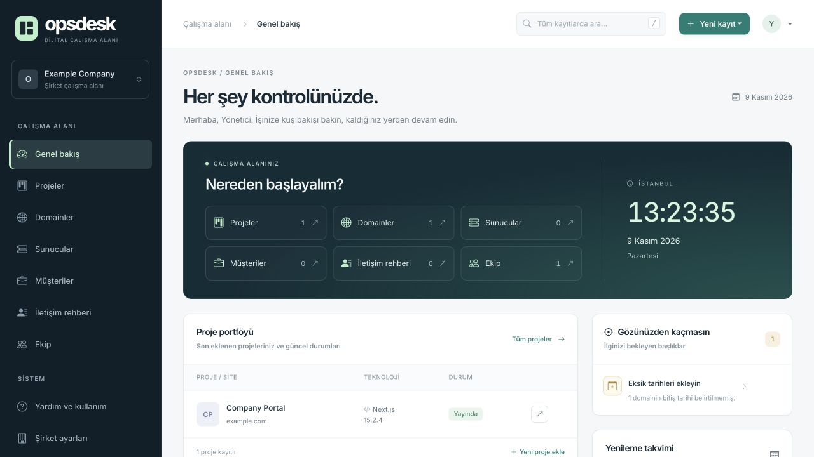

<div align="center">

# OpsDesk

**A self-hosted workspace for projects, infrastructure and teams.**

Node.js 20+ · Express · EJS · SQLite · Turkish interface

[Quick start](#quick-start) · [Walkthrough](docs/WALKTHROUGH.tr.md) · [Security](SECURITY.md) · [Contributing](CONTRIBUTING.md)

</div>

---

OpsDesk brings project records, domains, servers, customers and responsibilities into one searchable dashboard. Built for a company's internal team, it offers straightforward account management and source-aware infrastructure checks.

**This repository is a standalone, anonymized source distribution.** It starts with an empty database. It contains no company records, production accounts, real server addresses, access credentials, backups or encryption keys. Test credentials and sample records are synthetic.



*Preview uses synthetic records only; no sample database is shipped.*

## What you can do

- **Organize projects:** track domains, infrastructure, customers, technology versions and assigned team members.
- **Check domain records:** inspect RDAP/WHOIS data, DNS resolution and TLS certificates, with separate check states and timestamps.
- **Identify published technologies:** detect supported CMS, framework and library signatures; undisclosed versions remain unknown.
- **Manage internal accounts:** administrators create a starting password; users choose a personal password on first login. Creating accounts does not require invitation emails.
- **Find records quickly:** global search, filters, Turkish sorting and paginated lists.
- **Keep operational context:** backup settings, audit history and an administrator status page.
- **Work on smaller screens:** responsive lists, project cards and forms.

## Quick start

### 1. Install

```bash
git clone https://github.com/YankiOzarslan/opsdesk-company-panel.git
cd opsdesk-company-panel
npm ci --ignore-scripts
cp .env.example .env
```

Requires Node.js 20 or newer. No external database server or AI API key is required.

### 2. Configure your own account and secrets

In your local `.env`, choose `ADMIN_EMAIL`. Generate a password hash:

```bash
npm run hash-password -- "your-own-strong-password"
```

Copy the generated hash into `ADMIN_PASSWORD_HASH`. The quoted password above is a placeholder, not a shipped account password. Avoid putting a real password into shell history on a shared machine.

Generate two **different** random values for `JWT_SECRET` and `SESSION_SECRET`:

```bash
node -e "console.log(require('crypto').randomBytes(48).toString('hex'))"
```

Run the command separately for each secret. Never commit `.env` or the generated values.

### 3. Start

```bash
npm start
```

Open **http://localhost:4000**, then sign in with your configured administrator email and password. The database and local encryption key are generated on first start. If no initial password is configured in development, the server generates one and prints it locally; production requires explicit configuration.

### 4. Try the workflow

1. Open **Şirket ayarları** to enter your own workspace name.
2. Open **Kullanıcılar → Yeni kullanıcı** to add an employee and optionally a linked team record.
3. Add a domain and a server, then create a project and assign its team.
4. Use **Bilgileri getir** or **Siteden algıla** to inspect public information; review it before saving.
5. Open **Sistem durumu** to find missing links and backup settings.

See the [step-by-step Turkish walkthrough](docs/WALKTHROUGH.tr.md).

## Data and security model

| Area | Behavior |
| --- | --- |
| Installation | One company's shared workspace per installation; not a multi-tenant SaaS service. |
| Passwords | bcrypt hashes; starting passwords must be changed before accessing work records. |
| Access | Administrator checks and project assignment/role visibility enforced on the server. |
| Sensitive fields | AES-256-GCM encryption with a local key under `.secrets/`. |
| Forms | CSRF protection; account-scoped encrypted drafts. |
| History | Audited record changes; sensitive values are masked. |
| Public checks | External RDAP/WHOIS, DNS and HTTPS requests occur when requested or enabled. The queried domain/IP is sent to those services. |
| Backups | Database backups do **not** contain the encryption key. Securely back up that key separately. |

Never expose a development instance directly to the internet. For deployment, configure HTTPS, `NODE_ENV=production`, a correct `APP_URL`, secure cookies and persistent storage. Set `TRUST_PROXY=true` only behind a trusted reverse proxy.

SMTP is optional for password-reset emails. Domain checks cannot establish private ownership, hidden software versions or upgrade compatibility. A successful test suite is not a guarantee that a system has no vulnerabilities.

## Validate changes

```bash
npm run check:share
npm test
npm audit --omit=dev
```

Tests use temporary databases and mocked external services. GitHub Actions runs the suite on Node.js 20 and 22. Some integration tests open local HTTP listeners.

## Project layout

```text
src/          Application, access rules, database and service adapters
views/        Server-rendered screens
public/       Styles and browser scripts
scripts/      Local maintenance and sharing checks
test/         Automated tests with synthetic fixtures
docs/         Walkthrough
.env.example  Empty configuration template
```

## Scope

OpsDesk tracks operations; it does not provision DNS records, deploy sites, upgrade detected packages or verify the content of a company's backups. Runtime data, local secrets and generated files belong to the operator and must stay outside this repository.

No open-source license has been selected for this repository.
